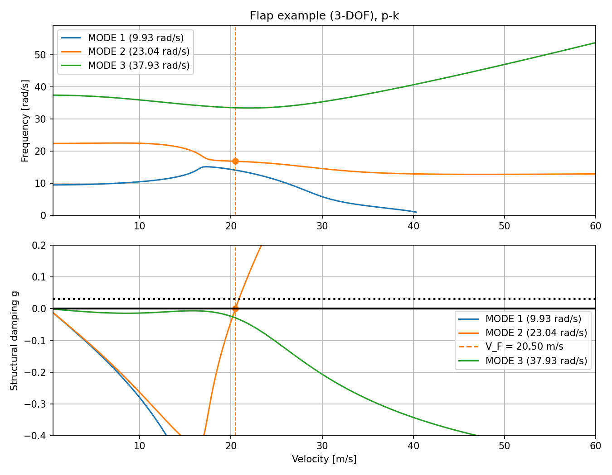

# p-k and k-Method Flutter Analysis of a Typical Section: Theory and Solvers

This document explains the physics and numerics behind `flutter2d/analysis/flutter.py` (p-k) and
`flutter2d/analysis/k_method.py` (k-method, selectable since issue #10), and records the change of p-k
solver made for issue #2 (commit `d147b89`): what the old secant solver did, why it failed,
what replaced it, and how the result was verified.

Figures are regenerated with `python docs/figures/make_figures.py`, which also prints the
verification table in section 10.

---

## 1. Purpose and scope

The tool finds the **flutter speed** of a two-degree-of-freedom airfoil section (the
"typical section"), optionally with a trailing-edge flap as a third degree of freedom
(section 8): the lowest airspeed at which one of its aeroelastic modes stops being
damped and starts to grow. It sweeps a velocity range and, at each speed, solves the
flutter equation for every structural mode with one of two methods:

- the **p-k method** (default, `"method": "pk"`; sections 4 and 6), which gives the true
  damping of each mode near `g = 0`;
- the **k-method** (`"method": "k"`; section 7), which sweeps the reduced frequency and gives
  the damping a mode would *need*. It finds the same flutter point by a non-iterative route
  and is useful as a cross-check.

Assumptions:

- 2D section, rigid in its own plane, on a heave spring and a torsion spring.
- Small motions about a zero-lift equilibrium (linear structure and aerodynamics).
- Incompressible, inviscid, attached flow over a thin airfoil (Theodorsen's theory).
- No structural damping in the model; damping is the *output* (sections 4 and 7).

Outside this envelope (high subsonic Mach number, stall, large amplitude, 3D effects) the
results should not be used without corrections.

---

## 2. Structural model

All lengths are measured along the chord in units of the semi-chord `b`, positive aft,
from mid-chord:

| Symbol | Meaning | Code |
|---|---|---|
| `b` | semi-chord (chord `c = 2b`) | `b_m` |
| `a` | elastic axis (EA) position aft of mid-chord, in semi-chords | `a_h_nd` |
| `x_α` | CG position aft of the EA, in semi-chords | `x_alpha_nd` |
| `m` | section mass | `mass_kg` |
| `I_α` | pitch inertia about the EA | `inertia_alpha_kg_m2` |
| `ω_h`, `ω_α` | uncoupled heave and pitch frequencies | `omega_heave_rad_s`, `omega_alpha_rad_s` |

The degrees of freedom are the heave `h` of the EA (**positive down**) and the pitch `α`
(**positive nose up**). Lift `L` is positive up and the moment `M_EA` about the EA is
positive nose up, following Theodorsen.

The equations of motion are

$$
m\ddot h + S_\alpha\ddot\alpha + k_h h = -L, \qquad
S_\alpha\ddot h + I_\alpha\ddot\alpha + k_\alpha\alpha = M_{EA},
\qquad S_\alpha = m\,b\,x_\alpha ,
$$

so the mass and stiffness matrices (`build_mass_matrix`, `build_stiffness_matrix`) are

$$
\mathbf M = \begin{bmatrix} m & m b x_\alpha \\ m b x_\alpha & I_\alpha \end{bmatrix},
\qquad
\mathbf K = \begin{bmatrix} k_h & 0 \\ 0 & k_\alpha \end{bmatrix},
\qquad k_h = m\omega_h^2,\; k_\alpha = I_\alpha\omega_\alpha^2 .
$$

The usual dimensionless groups are the mass ratio `μ = m/(πρb²)`, the radius of gyration
`r_α² = I_α/(m b²)` and the frequency ratio `σ = ω_h/ω_α`. `M` is positive definite only if
`r_α² > x_α²`; `compute_structural_frequencies` raises `ValueError` otherwise.

### Uncoupled vs coupled frequencies

`ω_h` and `ω_α` describe each spring with the other degree of freedom locked. When the CG is
off the EA (`x_α ≠ 0`) the off-diagonal mass term couples the two, and the actual in-vacuo
natural frequencies are the roots of `det(K − ω²M) = 0`, returned by
`compute_structural_frequencies`.

For `data/inputs/default.json` (`m = 10.4 kg`, `I_α = 1.12 kg m²`, `b = 0.5 m`,
`x_α = −0.5`) the coupling is strong: `m b² x_α² / I_α = 0.58`. The uncoupled frequencies of
20 and 21 rad/s become **15.43 and 42.02 rad/s** once coupled. That gap is the root cause of
issue #2 (section 5).

---

## 3. Unsteady aerodynamics

### Theodorsen's lift and moment

For harmonic motion of reduced frequency `k = bω/V`, Theodorsen's lift and moment about the
EA are

$$
L = \pi\rho b^2\left(\ddot h + V\dot\alpha - b a\ddot\alpha\right)
  + 2\pi\rho V b\, C(k)\left[\dot h + V\alpha + b\left(\tfrac12 - a\right)\dot\alpha\right]
$$

$$
M_{EA} = \pi\rho b^2\left[b a\ddot h - V b\left(\tfrac12 - a\right)\dot\alpha
  - b^2\left(\tfrac18 + a^2\right)\ddot\alpha\right]
  + 2\pi\rho V b^2\left(a + \tfrac12\right) C(k)\left[\dot h + V\alpha
  + b\left(\tfrac12 - a\right)\dot\alpha\right]
$$

The first bracket of each is non-circulatory (apparent mass and damping). The second is
circulatory: the lift of the quasi-steady downwash at the three-quarter chord,
`ḣ + Vα + b(½ − a)α̇`, acting at the quarter chord and reduced and lagged by the wake through
the Theodorsen function `C(k)`.

### The aerodynamic matrix

With `h = h̄ e^{iωt}`, `α = ᾱ e^{iωt}`, the loads are linear in `x̄ = [h̄, ᾱ]ᵀ`.
`build_aero_matrix` returns the 2×2 complex matrix `A(k)` defined by

$$
\rho\pi b V^2\,\mathbf A(k)\,\bar{\mathbf x} = \begin{bmatrix} -\bar L \\ \bar M_{EA} \end{bmatrix},
$$

so that, for example, `A₁₁ = k²/b − 2iC(k)k/b` is the heave-on-heave term of `−L` divided by
`ρπbV²`. The minus sign on `L` comes from `h` being positive down while `L` is positive up.

### The Theodorsen function and the Jones approximation

$$
C(k) = F(k) + iG(k) = \frac{H_1^{(2)}(k)}{H_1^{(2)}(k) + i H_0^{(2)}(k)},
$$

with `C → 1` as `k → 0` (quasi-steady) and `C → ½` as `k → ∞`. The code (`theo_c`) uses
R. T. Jones' two-pole rational approximation (NACA Report 681, from his fit to the Wagner
function):

$$
C(k) \approx 1 - \frac{0.165}{1 - 0.0455\,i/k} - \frac{0.335}{1 - 0.300\,i/k}.
$$

The largest error against the exact function is `|ΔC| = 0.0145` for `k ≤ 2`. Until
issue #9 the code used `0.041` and `0.32` in place of `0.0455` and `0.300`; that fit is worse
(largest `|ΔC| = 0.021`, near `k = 0.18`) and made the flutter speed noticeably low:

| Case | Old `0.041 / 0.32` | R. T. Jones (code) | Exact Theodorsen |
|---|---|---|---|
| Hodges & Pierce, `V_F/(bω_α)` | 2.1536 | 2.1704 | 2.1839 |
| Shipped defaults, `V_F` [m/s] | 19.393 | 19.558 | 19.575 |

So most of the gap between a two-pole fit and exact theory comes from the choice of
coefficients, not from the two-pole form itself.

---

## 4. The p-k flutter equation

### Derivation

Substituting the aerodynamic loads into the equations of motion and writing the motion as
`x̄ e^{st}` with complex `s = σ + iω` gives

$$
\left[s^2\mathbf M + \mathbf K - \rho\pi b V^2\,\mathbf A(k)\right]\bar{\mathbf x} = 0 .
$$

With the non-dimensional eigenvalue `p = s b / V` this is the form solved in the code:

$$
\mathbf F(p)\,\bar{\mathbf x} =
\left[\left(\tfrac{V}{b}\right)^2 p^2\,\mathbf M + \mathbf K - \rho\pi b V^2\,\mathbf A(k)\right]
\bar{\mathbf x} = 0,
\qquad k = \operatorname{Im}(p).
$$

The **p-k approximation** is the condition `k = Im(p)`: the aerodynamics are those of
harmonic motion at the mode's own frequency, even though the mode is actually growing or
decaying. This is exact only when `Re(p) = 0`, which is exactly the flutter point.

### Meaning of p, and the damping convention

| Quantity | Expression | Code |
|---|---|---|
| reduced frequency | `k = Im(p) = bω/V` | `np.imag(p)` |
| frequency [rad/s] | `ω = Im(p) V / b` | plotted on the V-f axis |
| decay-rate ratio | `γ = Re(p)/Im(p) = σ/ω` | |
| **damping** | **`g = 2γ = 2 Re(p)/Im(p)`** | `damping_g_nd` |

`g` is the flutter-analysis convention: the equivalent **structural damping** a mode has (if
negative) or would need (if positive) to be neutrally stable. For a lightly damped mode
`g ≈ −2ζ`, where `ζ` is the viscous damping ratio. A structure is commonly assumed to have
about `g = 0.03` (`γ = 1.5 %`) of structural damping, which is why the V-g plot carries a
`g = 0.03` line; the speed at which a mode crosses it is the flutter speed with that damping
allowed for.

### Flutter onset

Flutter onset is the first speed at which a mode's `g` goes from negative to non-negative.
`find_flutter_speed` finds the bracketing pair of sweep speeds and interpolates both speed
and frequency linearly in `g`, so the answer does not snap to the velocity grid.

### Relation to the k-method

The older **k-method** adds artificial structural damping, `K(1 + ig)`, and solves the
eigenproblem at fixed `k` for `Z = (1 + ig)/ω²`. Its `g` is the damping *required* for
harmonic motion. It has no physical meaning away from `g = 0` and its modes are hard to
track, but **at `g = 0` it solves exactly the same equation as the p-k method**. That makes
it a clean independent check of the flutter point (section 10), and it is available as an
alternative solver (section 7).

---

## 5. Old solver: secant iteration on det F (removed in `d147b89`)

### Algorithm

The old `compute_flutter` solved one mode per call, from one starting frequency `ω₀`:

1. At the first speed, `k₀ = ω₀ b / V₁`, with two starting points
   `p₁ = k₀(d₁ + i)` and `p₂ = k₀(d₂ + i)` (`d₁ = 0`, `d₂ = 0.01`).
2. Secant step on the scalar determinant, each `F` evaluated with `k = Im(p)`:
   `p₃ = (p₂ D₁ − p₁ D₂)/(D₁ − D₂)`, where `D_i = det F(p_i)`.
3. Stop when `|det F(p₃)| ≤ 0.001` (`det_tol_nd`).
4. Seed the next speed by scaling both points by `V/(V + ΔV)`, which keeps the physical
   eigenvalue `s = pV/b` fixed.

The TUI called it twice, with `ω₀ = ω_h` and `ω₀ = ω_α` (the *uncoupled* frequencies), and
labelled the results HEAVE and PITCH.

This is close to Hassig's original p-k formulation, which also iterated on the
determinant. The method is not wrong in principle; the failures were in seeding and
bookkeeping.

### Why it failed

- **Root selection.** A secant search on `det F(p)` converges to whichever root's basin the
  starting points are in. Nothing tied a call to a particular mode.
- **Seeding from uncoupled frequencies.** For `default.json` both starting frequencies
  (20 and 21 rad/s) are far from the upper coupled mode (42 rad/s) and both lie in the basin
  of the lower one (15.4 rad/s). Both calls returned the **same** mode, so the second mode
  was never solved and could never show flutter.
- **Tolerance with units.** `det F` has units of `k_h k_α` (N²/rad). The absolute tolerance
  `0.001` was therefore a relative tolerance of about `5 × 10⁻¹⁰` for `default.json`
  (`det K ≈ 2 × 10⁶`) but about `7 × 10⁻⁶` for the Hodges & Pierce section
  (`det K ≈ 150`). Its strictness depended on the units and size of the model.
- **No iteration cap.** If the secant step did not converge, the loop never ended.
- **No mode check.** Nothing detected two calls returning the same root, or a call jumping
  to another mode between speeds. The step `ΔV` was also taken from the first two points,
  which assumes a uniform grid.

In the left column of the figure the two old calls lie exactly on top of each other. In the
right column the new solver finds both modes (neither flutters for this input, which is
correct: the CG is ahead of the EA).

---

## 6. New solver: eigenvalue tracking

### The k iteration

For fixed `k` the p-k equation is a quadratic eigenproblem in `p` with no first-order term:

$$
\left(\tfrac{V}{b}\right)^2 p^2\,\mathbf M\,\bar{\mathbf x} = -\mathbf Q(k)\,\bar{\mathbf x},
\qquad \mathbf Q(k) = \mathbf K - \rho\pi b V^2 \mathbf A(k)
\;\;\Rightarrow\;\;
p^2 = -\left(\tfrac{b}{V}\right)^2 \operatorname{eig}\!\left(\mathbf M^{-1}\mathbf Q(k)\right).
$$

Each of the two eigenvalues `p²` gives a pair `±p`; the root with `Im(p) ≥ 0` is kept (the
other is its mirror). For each mode, `_solve_mode_at_speed`:

1. takes the current estimate `p`, sets `k = Im(p)` and computes the two candidate roots;
2. keeps the candidate **nearest the current estimate**;
3. updates `k` and repeats until `|Δk| ≤ k_tol · |k|` (`k_tol_nd`, default `10⁻¹⁰`).

### Seeding and mode identity

- At the first speed, each mode starts from its **coupled** structural frequency,
  `s = iω_i` (`compute_structural_frequencies`), so every mode has its own starting point.
- At the second speed the start is the first converged `s = pV/b`; from the third speed on it
  is extrapolated linearly in `V` from the previous two. `s` is the physical eigenvalue and varies smoothly with speed,
  whereas `p` grows like `1/V` at low speed.
- All modes are solved together at each speed. After each speed, if any two modes are
  closer than `10⁻⁶ max|s|`, the solver raises `ValueError` rather than return duplicates.

`compute_flutter` returns an array of shape `(n_modes, nv)`, modes ordered by ascending
structural frequency.

### Failure behaviour

The solver raises `ValueError` instead of returning a wrong answer when:

- `M` or `K` is not positive definite;
- the velocity sweep is empty, non-positive or not strictly increasing;
- two modes collapse onto one root (the remedy is more velocity points).

A single mode the iteration can no longer follow **ends** instead: its `p` is NaN from that
speed on, the other modes carry on, and the TUI prints a `[W]` with the speed. This happens
when the k iteration does not converge in `max_iter_nd` steps (default 200) or `k` falls to
zero. Both mean the root is leaving the oscillatory regime the p-k method assumes, either
towards static divergence or, common with a flap (section 8), because the mode is so heavily
damped (`g` of order −10 or below) that it is turning into a non-oscillatory subsidence.
Until issue #12 either case stopped the whole sweep with an error, which with three modes
would throw away a flutter point found at a lower speed.

---

## 7. k-method solver (`flutter2d/analysis/k_method.py`)

Selected with `"method": "k"` in the input file or `k` at the METHOD prompt; `"pk"` (the
default) selects section 6.

### Equation

With harmonic motion, `p = ik`, and artificial structural damping `K(1 + ig)`, the flutter
equation of section 4 becomes, after using `ρπbV² = ρπb³ω²/k²`,

$$
\left[ K^{-1}\left( M + \frac{\rho\pi b^3}{k^2} A(k) \right) \right] x = Z x,
\qquad Z = \frac{1 + ig}{\omega^2}.
$$

For each `k` this is a plain eigenproblem with no iteration. Every eigenvalue gives

$$
\omega = \frac{1}{\sqrt{\operatorname{Re} Z}}, \qquad V = \frac{b\omega}{k}, \qquad
g = \frac{\operatorname{Im} Z}{\operatorname{Re} Z}.
$$

### Sweep and branches

`compute_k_branches` sweeps `k` downwards (speed upwards) and keeps each branch by matching the
eigenvalues at one `k` to the nearest ones at the previous `k`. Branches start in ascending
frequency, so mode numbers match the p-k solver. `compute_flutter_k` chooses the `k` range from
the velocity range and the coupled frequencies (from `2bω_max/V_min` down to
`0.25bω_min/V_max`, `n_k_nd` = 4000 points, geometric). It then interpolates each branch's `ω`
and `g` linearly in `V` onto the requested velocity grid and returns them as an equivalent
`p = k(g/2 + i)`. That has the shape and meaning of the p-k output, so the table, plot,
exporter and `find_flutter_speed` are shared.

`V(k)` is not always monotonic. Approaching static divergence, the lower branch's speed peaks
and then falls again as `k → 0`. A branch is used from its lowest speed up to that peak; at
higher speeds the result is NaN (`-` in the table, `null` in the JSON, a gap in the plot), and
CHECK OUTPUT warns where the branch ends.

### What the k-method g means

The k-method `g` is the structural damping that would be *needed* for neutral harmonic
motion at that speed. It is not the damping the section actually has. Only at `g = 0` is the
motion truly harmonic, and there the equation is the p-k equation, so the two methods give
the same flutter speed and frequency. Away from `g = 0` the V-g curves differ, and in the
k-method the branches can behave differently from the p-k roots (here the lower branch folds
back instead of heading towards divergence):

Use the k-method to cross-check a flutter point. Read damping margins (the `g = 0.03` line)
from the p-k method.

### Failure behaviour

There is no iteration to fail, so the k-method raises `ValueError` only for invalid input:

- `M` or `K` not positive definite;
- the velocity sweep empty, non-positive or not strictly increasing;
- `n_k_nd < 2`, or (in `compute_k_branches`) a `k` sweep that is empty, non-positive or not
  strictly decreasing.

Speeds a branch does not reach are returned as NaN rather than raising. Unlike the p-k solver
it does not stop at static divergence: the lower branch simply ends at its fold.

---

## 8. Control-surface (flap) degree of freedom

With the four flap inputs (`c_hinge_nd`, `x_beta_nd`, `inertia_beta_kg_m2`,
`omega_beta_rad_s`; issue #12) the section gains a trailing-edge flap hinged at `x = c b`
(`−1 < c < 1`, in semi-chords aft of mid-chord), rotating by `β` (**positive trailing edge
down**) against a hinge spring. The aerodynamics are still 2D, incompressible and
Theodorsen's; only the number of degrees of freedom changes, from 2 to 3. Without the flap
inputs the two-DOF model of sections 2–3 runs unchanged.

### Structure

With `x = [h, α, β]ᵀ`, Theodorsen's mass matrix is

$$
\mathbf M = \begin{bmatrix}
m & S_\alpha & S_\beta \\
S_\alpha & I_\alpha & I_\beta + b(c - a)S_\beta \\
S_\beta & I_\beta + b(c - a)S_\beta & I_\beta
\end{bmatrix},
\qquad
\mathbf K = \operatorname{diag}(k_h,\, k_\alpha,\, k_\beta),
$$

with `S_α = m b x_α`, `S_β = m b x_β` (flap static moment about the hinge, `x_β` measured
aft of the hinge and normalised by the **total** mass `m`), `I_β` the flap inertia about the
hinge, `I_α` the inertia of the whole section (flap included) about the EA and
`k_β = I_β ω_β²`. A flap with its CG ahead of the hinge (`x_β < 0`) is mass-balanced.
`build_mass_matrix` and `build_stiffness_matrix` return these 3×3 matrices when given the
flap arguments.

### Aerodynamics

Theodorsen's flap terms depend on the hinge position through the geometric functions
`T₁ … T₁₃(c)` (NACA Report 496), e.g.

$$
T_4 = -\cos^{-1}c + c\sqrt{1 - c^2}, \qquad
T_{10} = \sqrt{1 - c^2} + \cos^{-1}c, \qquad
T_{11} = \cos^{-1}c\,(1 - 2c) + \sqrt{1 - c^2}\,(2 - c), \qquad
T_{12} = \sqrt{1 - c^2}\,(2 + c) - \cos^{-1}c\,(2c + 1).
$$

The quasi-steady downwash gains a flap term,
`Q = ḣ + Vα + b(½ − a)α̇ + (T₁₀/π)Vβ + (b T₁₁/2π)β̇`, which drives the circulatory lift,
pitching moment and (through `T₁₂`) the hinge moment `M_β`; each load also gains
non-circulatory flap terms. `build_aero_matrix(..., c_hinge_nd)` returns the 3×3 `A(k)` with
rows `[−L, M_EA, M_β]/(ρπbV²)`, so both solvers use it without change. The p-k and k-method
eigenproblems are simply 3×3, and branch tracking in the k-method tries all 3! = 6 orderings
per step.

### Checks of the flap terms

No published three-DOF flutter speed in a readable form was found, so the flap terms are
checked against limits and against independent theory (`tests/test_flutter.py`):

- **Hinge at the leading edge.** With `c = a = −1` a flap rotation is the same motion as a
  pitch about the leading edge, so the `β` row and column of `A(k)` must equal the `α` ones.
  They do, to 10⁻¹², at all `k` — a check of every `T` function and of the unsteady terms.
- **Steady lift of a flap.** At `k → 0` with `C = 1` the flap lift is thin-airfoil theory's
  `dC_L/dβ = 2(π − θ_h + sin θ_h)`, `cos θ_h = −c`.
- **Steady loads against a vortex lattice.** A 4000-panel lumped-vortex solution of the thin
  airfoil with a deflected flap reproduces the steady lift, pitching moment and hinge moment
  due to `α` and `β` to 10⁻⁴ (the lattice's discretisation error). This was a one-off check
  and is not part of the test suite.
- **Apparent mass.** The `k²` part of `A(k)` is symmetric and positive definite, as an
  added-mass matrix must be.
- **Stiff flap.** With `ω_β = 1000 rad/s` the flap barely moves and the two-DOF flutter
  speed of the shipped defaults (19.558 m/s) is recovered.
- **p-k = k-method.** Both solvers give the same flutter point for the flap example
  (section 10).

### Example

`data/inputs/flap_example.json` is the shipped-defaults section with a flap at `c = 0.6`
(80 % chord), `x_β = 0.0125` (CG slightly aft of the hinge, unbalanced),
`I_β = 0.0156 kg m²`, `ω_β = 30 rad/s`. The coupled in-vacuo frequencies are 9.93, 23.04
and 37.93 rad/s. Flutter is still bending-torsion: mode 2 crosses `g = 0` at 20.50 m/s,
16.86 rad/s, 5 % above the two-DOF section. The heave mode becomes so heavily damped that
p-k stops following it near 40 m/s (section 6). Lowering the flap frequency below the pitch
frequency changes the mechanism: at `ω_β = 15 rad/s` the flap mode flutters at 3.44 m/s,
classic unbalanced-aileron flutter, and both solvers agree on that too.

Near 17 m/s modes 1 and 2 approach (closest 4 rad/s apart in the complex plane) and veer,
exchanging character: mode 2 becomes the coupled bending-torsion mode that flutters, while
mode 1 takes over its heavy damping. This is not a tracking swap; a sweep four times finer
gives the same curves to 10⁻⁹.

---

## 9. Comparison

| | Old solver | New solver |
|---|---|---|
| Equation | `det F(p) = 0`, `k = Im(p)` | `F(p) x̄ = 0`, `k = Im(p)` |
| Iteration | secant on the scalar determinant | fixed point on `k`, 2×2 eigenproblem per step |
| Root selection | whichever root the secant reaches | nearest to the tracked estimate |
| Start, first speed | uncoupled `ω_h` or `ω_α` | coupled structural frequencies |
| Start, next speed | previous `p` × `V/(V+ΔV)` | linear extrapolation of `s = pV/b` |
| Modes per call | one | all, together |
| Convergence test | `\|det F\| ≤ 0.001` (absolute, has units) | `\|Δk\| ≤ 10⁻¹⁰ \|k\|` (relative) |
| Iteration cap | none | 200 |
| Duplicate modes | not detected | `ValueError` |
| Output | shape `(nv,)` per call | shape `(n_modes, nv)` |

Both solve the same equation, so wherever the old solver happened to land on the right
root the two agree. The difference is robustness and keeping track of which mode is which.

### p-k vs k-method

| | p-k (`flutter2d/analysis/flutter.py`) | k-method (`flutter2d/analysis/k_method.py`) |
|---|---|---|
| Swept variable | speed `V` | reduced frequency `k` (`V` is an output) |
| Unknown | complex `p` per mode | `Z = (1 + ig)/ω²` per branch |
| Solution per point | fixed-point iteration on `k` | one eigenproblem, no iteration |
| Damping `g` | true damping, `2 Re(p)/Im(p)` | required damping, `Im Z / Re Z` |
| Meaning away from `g = 0` | approximate but physical | not physical |
| Flutter point | `g = 0` crossing | same point (same equation at `g = 0`) |
| Mode tracking | extrapolation in `V` | nearest eigenvalue in `k` |
| Near divergence or overdamping | mode ends (NaN) when `k → 0` | branch folds back; NaN beyond the fold |
| Settings | `k_tol_nd`, `max_iter_nd` | `n_k_nd` |
| Use for | flutter speed and damping margins | cross-checking the flutter point |

---

## 10. Verification

An independent **k-method** solver, written directly from Theodorsen's `L` and `M_EA`
(section 3) and sharing no code with `flutter2d/analysis/flutter.py`, is in
`docs/figures/make_figures.py`. At `g = 0` it must agree with the p-k solver exactly
(section 4). It is kept separate from the program's own k-method (section 7), which reuses
`build_aero_matrix` and so would not catch an error there; `tests/test_k_method.py` checks
that one against the same flutter points.

| Case | p-k `V_F` | p-k `ω_F` | k-method `V_F` | k-method `ω_F` | Exact `C(k)` `V_F` |
|---|---|---|---|---|---|
| Hodges & Pierce (`V_F/bω_α`, `ω_F/ω_α`) | 2.17036 | 0.64433 | 2.17036 | 0.64433 | 2.18389 |
| Shipped defaults (m/s, rad/s) | 19.55820 | 16.01076 | 19.55813 | 16.01074 | 19.57463 |
| `data/inputs/default.json` | none | | none | | none |
| `data/inputs/flap_example.json` (3-DOF, m/s, rad/s) | 20.4965 | 16.8588 | 20.4967 | 16.8592 | |

The Hodges & Pierce section (*Introduction to Structural Dynamics and Aeroelasticity*,
ch. 5) has `a = −1/5`, `x_α = 1/10`, `μ = 20`, `r_α² = 6/25`, `σ = 2/5`. The shipped
defaults are those of `defaults/default_flutter.json`. p-k and k-method agree to 5–6
significant figures. With the exact Theodorsen function the flutter speed is 0.6 % (Hodges &
Pierce) and 0.1 % (shipped defaults) higher, which is the cost of the Jones approximation
(section 3).

Both cases show classic bending-torsion (coalescence) flutter: as speed rises the two
frequencies approach, and the upper mode's damping turns positive. The lower mode becomes
heavily damped and heads towards static divergence.

With the CG ahead of the EA (`x_α < 0`) the section does not flutter in the range.

### Tests

| Claim | Test (`tests/test_flutter.py`) |
|---|---|
| Hodges & Pierce flutter speed and frequency | `test_compute_flutter_hodges_pierce_textbook_case` |
| Shipped-defaults flutter speed | `test_compute_flutter_detects_flutter_speed` |
| Modes stay distinct (issue #2) | `test_compute_flutter_keeps_modes_distinct` |
| Coupled frequencies | `test_compute_structural_frequencies_uncoupled` |
| Interpolated onset | `test_find_flutter_speed_interpolates_between_grid_points` |
| `g = 2γ` | `test_damping_g_nd_is_twice_decay_rate_ratio` |
| `C(k) → ½` | `test_theo_c_approaches_half_at_high_k` |
| k-method flutter point = p-k (both cases) | `tests/test_k_method.py` |
| k-method branch ends at its fold | `test_k_method_branch_is_nan_beyond_its_fold` |
| Flap rows/columns = pitch with hinge at the LE | `test_aero_matrix_flap_hinged_at_leading_edge_equals_pitch_about_it` |
| Steady flap lift = thin-airfoil theory | `test_aero_matrix_flap_steady_lift_matches_thin_airfoil_theory` |
| Flap apparent mass symmetric, positive definite | `test_aero_matrix_flap_added_mass_is_symmetric_positive_definite` |
| Stiff flap recovers the two-DOF speed | `test_compute_flutter_stiff_flap_recovers_two_dof_speed` |
| Flap example flutter point, p-k mode ends | `test_compute_flutter_three_dof_flap_example` |
| Flap example, k-method = p-k | `test_k_method_three_dof_flap_example_matches_pk` |

---

## 11. Limitations and possible extensions

- **Jones approximation.** The two-pole `C(k)` makes the flutter speed 0.1–0.6 % low in
  the verified cases. The exact Theodorsen function (Hankel functions) would remove this
  but needs Bessel functions the code does not otherwise depend on.
- **Incompressible, thin-airfoil aerodynamics.** No Mach effects; no thickness, camber or
  viscous effects; no stall.
- **No structural damping input.** `g` is an output; a damping margin is read off the plot
  against the `g = 0.03` line rather than included in the model.
- **p-k damping away from `g = 0` is approximate**, because the aerodynamics assume
  harmonic motion.
- **Mode swaps are not detected.** The collapse check catches two modes on one root, but if
  a coarse grid near frequency coalescence lets two modes exchange identities, it is not
  reported. More velocity points avoid it.
- **k-method branches can fold back** (`V(k)` not monotonic); speeds beyond the fold are
  not reported for that branch (section 7).
- **Divergence is not computed.** A p-k mode whose `k → 0` simply ends (section 6); the
  divergence speed is not reported, and an ended mode does not say whether it diverged or
  became overdamped.
- **Flap model.** Sealed hinge gap, no aerodynamic balance (overhang), rigid flap and no
  freeplay or hinge friction; the hinge spring is linear and undamped. Not validated
  against a published three-DOF flutter speed (section 8).
- **Extensions:** a structural damping input, compressibility corrections, a
  divergence-speed calculation, control-surface aerodynamic balance.

---

## 12. Nomenclature and references

| Symbol | Meaning | Code |
|---|---|---|
| `a` | EA position aft of mid-chord / `b` | `a_h_nd` |
| `A(k)` | aerodynamic matrix | `build_aero_matrix` |
| `b` | semi-chord | `b_m` |
| `c` | flap hinge position aft of mid-chord / `b` (section 8) | `c_hinge_nd` |
| `C(k) = F + iG` | Theodorsen function | `theo_c` |
| `g` | damping, `2 Re(p)/Im(p)` (p-k); required damping `Im Z/Re Z` (k-method) | `damping_g_nd` |
| `γ` | decay-rate ratio, `Re(p)/Im(p)` | |
| `h` | heave of the EA, positive down | |
| `I_α` | pitch inertia about the EA | `inertia_alpha_kg_m2` |
| `I_β` | flap inertia about the hinge | `inertia_beta_kg_m2` |
| `k` | reduced frequency `bω/V = Im(p)` | |
| `k_h`, `k_α` | heave and pitch stiffness | `k_heave_n_m`, `k_alpha_nm_rad` |
| `L`, `M_EA` | lift (up), moment about the EA (nose up) | |
| `M_β` | hinge moment (trailing edge down) | |
| `m` | section mass | `mass_kg` |
| `M`, `K` | mass and stiffness matrices | `build_mass_matrix`, `build_stiffness_matrix` |
| `p` | non-dimensional eigenvalue `s b / V` | rows of `compute_flutter` (and `compute_flutter_k`) output |
| `r_α²` | `I_α/(m b²)` | |
| `s = σ + iω` | physical eigenvalue | |
| `S_β` | flap static moment about the hinge, `m b x_β` | |
| `T₁ … T₁₃` | Theodorsen's flap geometry functions of `c` | `_theodorsen_t_nd` |
| `V`, `V_F` | airspeed, flutter speed | `velocity_range_m_s`, `find_flutter_speed` |
| `x_α` | CG position aft of the EA / `b` | `x_alpha_nd` |
| `x_β` | flap CG aft of the hinge / `b`, normalised by the total mass | `x_beta_nd` |
| `Z` | k-method eigenvalue `(1 + ig)/ω²` | `compute_k_branches` |
| `α` | pitch, positive nose up | |
| `β` | flap rotation, positive trailing edge down | |
| `μ` | mass ratio `m/(πρb²)` | |
| `ρ` | air density | `rho_kg_m3` |
| `σ` | frequency ratio `ω_h/ω_α` (section 2); real part of `s` (section 4) | |
| `ω_h`, `ω_α` | uncoupled heave and pitch frequencies | `omega_heave_rad_s`, `omega_alpha_rad_s` |
| `ω_β` | uncoupled flap frequency, `√(k_β/I_β)` | `omega_beta_rad_s` |

1. T. Theodorsen, *General Theory of Aerodynamic Instability and the Mechanism of
   Flutter*, NACA Report 496, 1935.
2. R. T. Jones, *The Unsteady Lift of a Wing of Finite Aspect Ratio*, NACA Report 681, 1940.
3. H. J. Hassig, "An Approximate True Damping Solution of the Flutter Equation by
   Determinant Iteration", *Journal of Aircraft* 8(11), 885–889, 1971.
4. D. H. Hodges and G. A. Pierce, *Introduction to Structural Dynamics and Aeroelasticity*,
   2nd ed., Cambridge University Press, 2011, ch. 5.
5. R. L. Bisplinghoff, H. Ashley and R. L. Halfman, *Aeroelasticity*, Addison-Wesley, 1955
   (Dover reprint, 1996).
